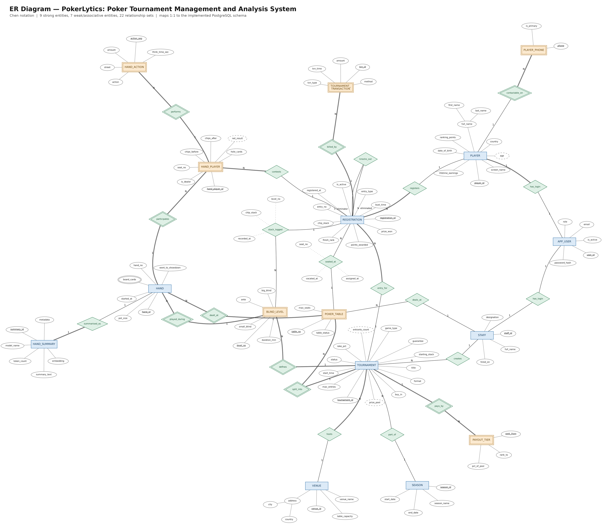
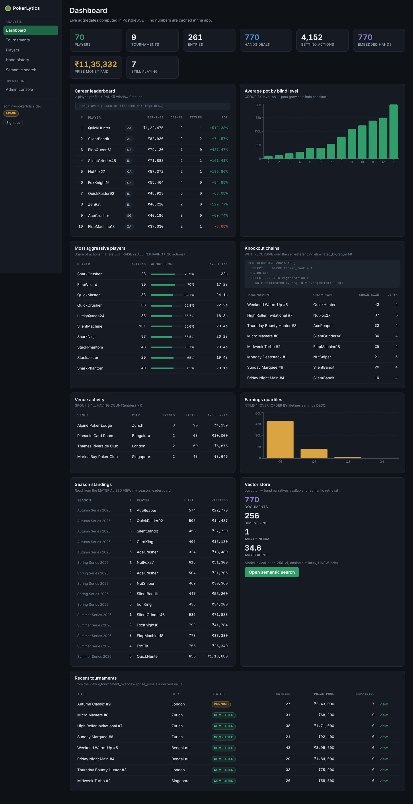
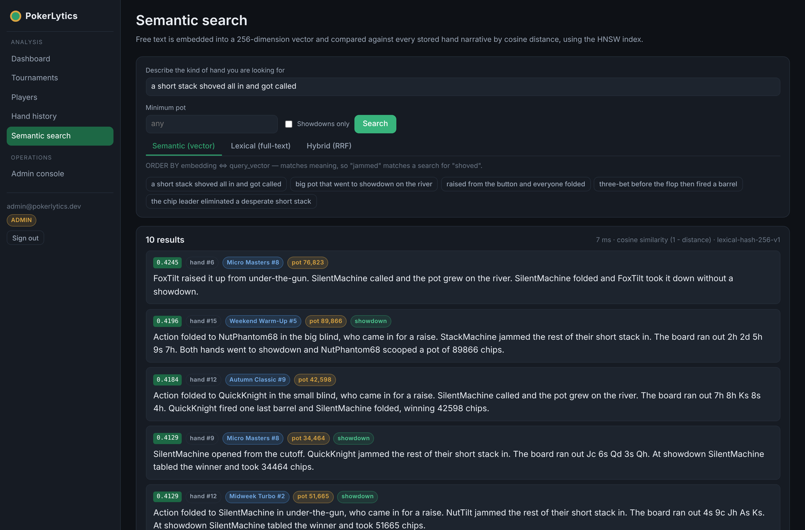

# PokerLytics — Poker Tournament Management and Analysis System

**DBMS Experiential Learning — Level 3 Mini-Project**
PES University, Department of Computer Science and Engineering
Aug–Dec 2026

---

## Table of contents

1. [Problem statement](#1-problem-statement)
2. [Objectives](#2-objectives)
3. [Scope](#3-scope)
4. [Functional requirements](#4-functional-requirements)
5. [ER diagram](#5-er-diagram)
6. [Relational schema](#6-relational-schema)
7. [Database choice and justification](#7-database-choice-and-justification)
8. [Data dictionary](#8-data-dictionary)
9. [SQL implementation](#9-sql-implementation)
10. [Vector database implementation](#10-vector-database-implementation)
11. [Important queries](#11-important-queries)
12. [Advanced database features](#12-advanced-database-features)
13. [System architecture](#13-system-architecture)
14. [Security](#14-security)
15. [Application screenshots](#15-application-screenshots)
16. [Testing results](#16-testing-results)
17. [Conclusion and future enhancements](#17-conclusion-and-future-enhancements)

---

## 1. Problem statement

A multi-day poker tournament is a demanding data-management problem that the
industry still runs largely on spreadsheets and paper.

During a single event, a tournament director must track hundreds of entries
across dozens of tables, move players between tables as the field shrinks,
maintain an accurate chip count for every surviving entrant, record who
eliminated whom, and finally distribute a prize pool that must reconcile
exactly with the money taken at the cash desk. A single arithmetic error is
a financial and regulatory problem, not merely an inconvenience.

Three properties make this genuinely hard, and all three are database
problems rather than interface problems:

**Operations must be all-or-nothing.** Registering a player takes money,
creates an entry, allocates a seat and issues a starting stack. If the
system records the payment but not the seat, the player has paid to stand
up. These multi-table writes must be atomic.

**Integrity rules span several tables.** A seat can hold one player. Chips
won by one player must have been lost by another. Prizes paid cannot exceed
the pool collected. No single-row validation can express any of these.

**The most valuable data is unstructured.** The strategically interesting
question is not "how many hands did this player win" but "show me the spots
where this player shoved a short stack into a raiser". That question is
about *meaning*, and keyword search cannot answer it — a hand described as
"jammed" will never match a search for "shoved", even though the two words
describe the same action.

PokerLytics addresses all three. It is a tournament management and analysis
system built on PostgreSQL, where transactional correctness is enforced by
the database engine, and a pgvector embedding layer makes the hand history
searchable by meaning rather than by keyword.

This is deliberately not a CRUD application. The majority of the logic —
seating, table balancing, elimination chains, payout distribution, career
statistics — lives in stored procedures, triggers, views and constraints,
with the web application acting as a presentation layer over them.

---

## 2. Objectives

1. Model a poker tournament domain with correct ER semantics: strong and
   weak entities, identifying relationships, composite, multivalued and
   derived attributes, and a recursive relationship.
2. Convert that model into a normalised relational schema in **3NF/BCNF**
   with complete primary key, foreign key, `CHECK`, `UNIQUE` and `NOT NULL`
   coverage.
3. Enforce every business rule **inside the database**, so the rules hold
   for any client, not only for this web application.
4. Demonstrate advanced database features in service of real requirements:
   transactions, views, stored procedures, triggers, indexing, full-text
   search and vector similarity search.
5. Implement a hybrid storage strategy — relational storage for structured
   tournament data, vector storage for unstructured hand narratives — and
   justify each choice from the nature of the data.
6. Build a functional Next.js interface that exposes the database
   functionality through forms, tables, filters, dashboards and search.
7. Implement authentication and **role-based access control enforced at the
   database level** through roles, grants and row-level security.
8. Produce a dataset large enough that the analytical queries return
   meaningful results rather than trivial ones.

---

## 3. Scope

### In scope

| Area | What is covered |
|------|-----------------|
| Identity | User accounts, three roles, player and staff profiles |
| Events | Venues, seasons, tournaments, blind structures, payout ladders |
| Participation | Registration, re-entry, buy-ins, re-buys, refunds |
| Floor operations | Table creation, seat allocation, table balancing, chip counts |
| Gameplay | Hands, participants, street-by-street betting actions, showdowns |
| Results | Eliminations, finishing order, prize distribution, ranking points |
| Analysis | Career statistics, positional win rates, aggression indices, knockout chains, season leaderboards |
| Semantic layer | Hand narratives, embeddings, similarity search, hybrid retrieval |
| Governance | Audit trail, database roles, row-level security |

### Out of scope

These were consciously excluded to keep the project deliverable at the
required depth rather than spread thin:

- **Side-pot arithmetic.** Each hand carries a single `pot_size`. Modelling
  main and side pots for multi-way all-ins would add an entire table and
  settlement algorithm without demonstrating any new database concept.
- **Hand-strength evaluation.** The system records which cards were shown
  but does not rank poker hands; that is a combinatorial problem, not a
  data-management one.
- **Live multi-user concurrency at scale.** Row locking (`FOR UPDATE`) is
  used correctly in the registration and payout procedures, but the system
  has not been load-tested with concurrent dealers.
- **Payment gateway integration.** Transactions are recorded with a method
  and reference number; no real payment processor is contacted.

Stating these explicitly is deliberate: a scope boundary that has been
reasoned about is a design decision, while one that is discovered during
the viva is an oversight.

---

## 4. Functional requirements

### FR1 — Authentication and authorisation
- FR1.1 A user signs in with an e-mail address and password.
- FR1.2 Passwords are stored only as bcrypt hashes (cost 10).
- FR1.3 Three roles exist: `ADMIN`, `DIRECTOR`, `PLAYER`.
- FR1.4 Each application role maps to a PostgreSQL role; the connection is
  escalated per request with `SET LOCAL ROLE`.
- FR1.5 A `PLAYER` may read only their own registration rows, enforced by
  row-level security.

### FR2 — Tournament management
- FR2.1 A director creates a tournament with venue, buy-in, rake, format
  and starting stack.
- FR2.2 Creating a tournament generates its blind structure, payout ladder
  and tables in one transaction.
- FR2.3 Tournaments move through `SCHEDULED → RUNNING → COMPLETED`.
- FR2.4 The prize pool is derived, never stored.

### FR3 — Registration
- FR3.1 A player registers for a tournament through `sp_register_player`,
  which creates the entry, records payment, allocates the emptiest seat and
  logs the starting stack atomically.
- FR3.2 Re-entry is permitted only when the format is `REENTRY`.
- FR3.3 Registration is refused once the field is full, enforced by a
  `CHECK` constraint on a trigger-maintained counter.

### FR4 — Floor operations
- FR4.1 Exactly one live occupant per seat, enforced by a partial unique index.
- FR4.2 An entry may occupy only one seat at a time.
- FR4.3 `sp_balance_tables` moves players off the shortest table and breaks it.
- FR4.4 Chip counts are snapshotted per blind level.

### FR5 — Gameplay recording
- FR5.1 A hand records its table, level, board, pot and showdown flag.
- FR5.2 Each participant records hole cards, seat, and chips before/after.
- FR5.3 `net_result` is a generated column and cannot drift.
- FR5.4 A hand is refused unless chips balance to zero across participants.
- FR5.5 Every betting action records street, sequence, type, amount and think time.

### FR6 — Results and payouts
- FR6.1 `sp_eliminate_player` busts an entry, transfers its chips to the
  eliminator, assigns the finishing position and frees the seat.
- FR6.2 The eliminator is recorded via a self-referencing foreign key.
- FR6.3 `sp_calculate_payouts` derives the pool, walks the ladder, writes
  prizes and points, creates payout transactions, releases seats and
  refreshes the season leaderboard — atomically.
- FR6.4 Paying out twice, or while players remain, is refused.
- FR6.5 Career earnings update automatically by trigger.

### FR7 — Analysis
- FR7.1 Career leaderboard with earnings, cash rate, titles and ROI.
- FR7.2 Positional win rate per player.
- FR7.3 Aggression index from recorded actions.
- FR7.4 Chip trajectory across blind levels.
- FR7.5 Knockout chains computed with a recursive CTE.
- FR7.6 Season standings from a materialised view.
- FR7.7 Financial reconciliation per tournament.

### FR8 — Semantic search
- FR8.1 Every hand has a natural-language narrative.
- FR8.2 Each narrative is embedded as a 256-dimension vector.
- FR8.3 Free-text search ranks hands by cosine similarity.
- FR8.4 Results can be pre-filtered by tournament, pot size and showdown.
- FR8.5 Lexical (full-text) and hybrid (RRF) modes are available for comparison.
- FR8.6 Summaries support create, read, update and delete, with re-embedding on update.

### FR9 — Audit and integrity
- FR9.1 Significant changes are written to an audit log by trigger.
- FR9.2 The audit log is append-only, enforced by trigger.
- FR9.3 Deleting a paid entry is refused; a refund procedure exists instead.

---

## 5. ER diagram

The full diagram is at [`docs/er-diagram.png`](er-diagram.png), with an
editable version at [`docs/er-diagram.drawio`](er-diagram.drawio)
(open at <https://app.diagrams.net>).



### Entity inventory

**Strong entities (9):** `APP_USER`, `PLAYER`, `STAFF`, `VENUE`, `SEASON`,
`TOURNAMENT`, `REGISTRATION`, `HAND`, `HAND_SUMMARY`

**Weak and associative entities (7):** `PLAYER_PHONE`, `BLIND_LEVEL`,
`PAYOUT_TIER`, `POKER_TABLE`, `TOURNAMENT_TRANSACTION`, `HAND_PLAYER`,
`HAND_ACTION`

`AUDIT_LOG` is intentionally absent from the conceptual diagram. It is an
operational table written by triggers and deliberately carries **no foreign
key** to the rows it describes — if it did, deleting an audited row would
either destroy its own audit record or be blocked by it. An audit trail
that disappears with the evidence is not an audit trail.

### Notation features present

| ER construct | Where it appears |
|---|---|
| Strong entity | `PLAYER`, `TOURNAMENT`, `HAND`, … |
| Weak entity (double rectangle) | `BLIND_LEVEL`, `PAYOUT_TIER`, `POKER_TABLE`, `PLAYER_PHONE` |
| Identifying relationship (double diamond) | `defines`, `pays_by`, `split_into`, `contactable_on`, `dealt_at`, `played_during`, `participates`, `performs`, `billed_by` |
| Associative entity | `HAND_PLAYER` — resolves the M:N between `REGISTRATION` and `HAND`, and owns `HAND_ACTION` |
| Primary key (underlined) | `player_id`, `tournament_id`, … |
| Partial key (dashed underline) | `level_no`, `rank_from`, `table_no`, `phone` |
| Composite attribute | `full_name` → (`first_name`, `last_name`); `address` → (`city`, `country`) |
| Multivalued attribute (double ellipse) | `board_cards` |
| Derived attribute (dashed ellipse) | `age`, `prize_pool`, `entrants_count`, `net_result` |
| Relationship attribute (dotted line) | `seat_no`/`assigned_at` on `seated_at`; `chip_stack`/`level_no` on `stack_logged` |
| 1:1 | `APP_USER` — `has_login` — `PLAYER` |
| 1:N | `VENUE` — `hosts` — `TOURNAMENT` |
| M:N | `REGISTRATION` — `HAND` (via `HAND_PLAYER`) |
| Recursive relationship | `knocks_out` on `REGISTRATION`, with roles *eliminator* and *eliminated* |
| Total participation (double line) | Every entry must belong to a player and a tournament |

### Three design decisions worth defending

**`REGISTRATION` is the pivot, not `PLAYER`.** Everything that happens
during an event — seat, chips, hands, result, money — attaches to the
*entry*, not the person. This is what makes re-entry representable: the
same player can hold two simultaneous entries in one tournament. A design
keyed on `(player_id, tournament_id)` makes that impossible.

**`HAND_PLAYER` is an associative entity, not a relationship.** In Chen
notation a relationship cannot own a dependent entity, and `HAND_ACTION`
depends on a specific participant of a specific hand. Promoting the M:N
link to an entity is what lets actions attach to it.

**`USER_ACCOUNT` is not connected to `REGISTRATION`.** The path
`APP_USER → PLAYER → REGISTRATION` already exists. A direct edge would be a
*redundant relationship* — derivable by traversal, and capable of holding
contradictory facts (an entry whose account disagrees with its player).

---

## 6. Relational schema

Full detail, including every constraint and the ER-to-relational conversion
reasoning, is in [`RELATIONAL_SCHEMA.md`](RELATIONAL_SCHEMA.md).

```
app_user(user_id PK, email UK, password_hash, role, is_active, created_at, last_login_at)

player(player_id PK, user_id FK→app_user UK, screen_name UK, first_name, last_name,
       date_of_birth, country, lifetime_earnings, ranking_points, created_at)

player_phone(player_id PK FK→player, phone PK, is_primary)

staff(staff_id PK, user_id FK→app_user UK, full_name, designation, hired_on)

venue(venue_id PK, venue_name, address_line, city, country, table_capacity)
      UNIQUE(venue_name, city)

season(season_id PK, season_name UK, start_date, end_date)

tournament(tournament_id PK, venue_id FK→venue, season_id FK→season,
           created_by FK→staff, title UK, game_type, format, buy_in, rake_pct,
           guarantee, starting_stack, max_entries, start_time, status,
           entrants_count, created_at)

blind_level(tournament_id PK FK→tournament, level_no PK, small_blind, big_blind,
            ante, duration_min, is_break)

payout_tier(tournament_id PK FK→tournament, rank_from PK, rank_to, pct_of_pool)

registration(registration_id PK, tournament_id FK→tournament, player_id FK→player,
             entry_type, entry_no, registered_at, chip_stack, is_active,
             finish_rank, bust_time, eliminated_by_reg_id FK→registration,
             prize_won, points_awarded)
             UNIQUE(tournament_id, player_id, entry_no)

tournament_transaction(txn_id PK, registration_id FK→registration, txn_type,
                       amount, method, txn_time, reference_no UK)

poker_table(table_id PK, tournament_id FK→tournament, table_no, max_seats,
            dealer_id FK→staff, status)
            UNIQUE(tournament_id, table_no)

seat_assignment(seat_id PK, table_id FK→poker_table,
                registration_id FK→registration, seat_no, assigned_at, vacated_at)
                UNIQUE(table_id, seat_no) WHERE vacated_at IS NULL
                UNIQUE(registration_id)   WHERE vacated_at IS NULL

chip_count_log(log_id PK, registration_id FK→registration,
               (tournament_id, level_no) FK→blind_level, chip_stack, recorded_at)
               UNIQUE(registration_id, level_no)

hand(hand_id PK, table_id FK→poker_table, (tournament_id, level_no) FK→blind_level,
     hand_no, board_cards, pot_size, rake_taken, went_to_showdown,
     started_at, ended_at)
     UNIQUE(table_id, hand_no)

hand_player(hand_player_id PK, hand_id FK→hand, registration_id FK→registration,
            seat_no, hole_cards, is_dealer, chips_before, chips_after,
            net_result GENERATED)
            UNIQUE(hand_id, registration_id), UNIQUE(hand_id, seat_no)

hand_action(action_id PK, hand_id FK→hand, hand_player_id FK→hand_player,
            street, action_seq, action, amount, pot_after, think_time_sec)
            UNIQUE(hand_id, action_seq)

hand_summary(summary_id PK, hand_id FK→hand UK, summary_text, embedding VECTOR(256),
             model_name, metadata JSONB, search_tsv GENERATED, token_count,
             created_at, updated_at)

audit_log(audit_id PK, table_name, operation, row_pk, changed_by, changed_at,
          old_data JSONB, new_data JSONB)
```

### Normalisation

The schema is in **Third Normal Form**, and every table is in **BCNF**.

- **1NF** — every attribute is atomic. The multivalued ER attribute `phone`
  became its own relation `player_phone` rather than a comma-separated
  column. `board_cards` is retained as a single formatted string because it
  is always read as a unit and never searched by individual card; this is
  documented as a deliberate denormalisation.
- **2NF** — no partial dependency on part of a composite key. In
  `blind_level(tournament_id, level_no)`, every non-key attribute depends on
  the whole key: `small_blind` is meaningless without knowing both which
  tournament and which level.
- **3NF** — no transitive dependency. `venue_name` and `city` live on
  `venue`, not on `tournament`; `screen_name` lives on `player`, not copied
  onto `registration`.
- **BCNF** — every determinant is a candidate key. The non-trivial
  functional dependencies are all of the form *(candidate key) → attributes*.

**Controlled denormalisation.** Two fields are stored redundantly, each for
a stated reason:

| Field | Why it is stored | How drift is prevented |
|---|---|---|
| `tournament.entrants_count` | A `CHECK` constraint cannot count rows in another table; storing the count lets the constraint enforce the field cap | Maintained by trigger `tr_entrants_count` on every insert and delete |
| `player.lifetime_earnings` | Recomputing a career total on every leaderboard read would scan the whole results history | Maintained by trigger `tr_sync_player_earnings`, verified by test T20 |

By contrast, `prize_pool`, `age` and `net_result` are **not** stored —
they are computed by `fn_prize_pool()`, `fn_player_age()` and a generated
column respectively, because nothing requires them to be materialised.

---

## 7. Database choice and justification

The full argument, including what was rejected and why, is in
[`TECHNOLOGY_JUSTIFICATION.md`](TECHNOLOGY_JUSTIFICATION.md). In summary:

### PostgreSQL 16 for the structured core

The tournament data is **relational, highly interconnected and
correctness-critical**. It has eighteen entity types with twenty-five
foreign-key relationships, and it carries money.

- **Money demands ACID.** Registration writes four tables; payout writes
  three plus a materialised view. Partial completion is a financial error.
- **The integrity rules are relational.** "One live occupant per seat",
  "chips must balance", "payouts cannot exceed the pool" are constraints
  over sets of rows — exactly what a relational engine expresses natively.
- **The questions are joins.** Almost every analytical query traverses four
  to six tables. A document store would require either denormalisation or
  application-side joins.

MySQL was the other permitted option and would have served the relational
half competently. PostgreSQL was chosen because it also provides pgvector,
`WITH RECURSIVE`, generated columns, partial indexes, `FILTER`, row-level
security and native `JSONB` — all used in this project.

### pgvector for the semantic layer

Hand narratives are **unstructured prose where the useful queries are about
meaning**. "Find spots where a short stack shoved into a raiser" cannot be
expressed as `LIKE '%shove%'`, because the corpus says "jammed".

The decisive argument for pgvector over a standalone vector database
(Pinecone, Chroma, Qdrant) is **co-location**:

```sql
SELECT h.hand_id, t.title, hs.summary_text,
       1 - (hs.embedding <=> $1) AS similarity
  FROM hand_summary hs
  JOIN hand h       ON h.hand_id = hs.hand_id
  JOIN tournament t ON t.tournament_id = h.tournament_id
 WHERE h.went_to_showdown              -- relational predicate
   AND h.pot_size > 5000               -- relational predicate
   AND hs.metadata @> '{"all_in":true}'-- JSONB predicate
 ORDER BY hs.embedding <=> $1          -- vector ANN
 LIMIT 10;
```

One query, one transaction, one consistency model. With an external vector
service the application would query it for ids, then query PostgreSQL to
hydrate them, with no transactional guarantee that the two agree — and a
deleted hand would leave an orphaned vector. Here `ON DELETE CASCADE`
removes the embedding with the hand, proven by test T07.

### Why this is a genuine hybrid, not technology for its own sake

Requirement 18 warns against including a database paradigm merely to
demonstrate it. The test is whether the second paradigm earns its place.
It does: the lexical search mode in the application exists specifically to
show the gap. Searching the corpus for `"shoved"` with full-text returns
hands containing that word; the same query by embedding also returns hands
that say "jammed", "moved all in" and "committed the rest of their stack".
Both modes are in the UI side by side so the difference is demonstrable
rather than merely asserted.

---

## 8. Data dictionary

The complete column-by-column dictionary — 147 columns across 19 tables,
with types, nullability, constraints and descriptions — is in
[`DATA_DICTIONARY.md`](DATA_DICTIONARY.md).

Summary of schema objects, as reported by `npm run db:setup`:

| Object | Count |
|---|---|
| Base tables | 19 |
| Views | 7 |
| Materialised views | 1 |
| Indexes | 63 |
| Triggers | 10 |
| Functions (user-defined) | 14 |
| Stored procedures | 7 |
| `CHECK` constraints | 47 |
| Foreign keys | 25 |
| `UNIQUE` constraints | 15 |
| Primary keys | 19 |
| **Total constraints** | **106** |

---

## 9. SQL implementation

All DDL lives in `db/`, executed in order by `npm run db:setup`.

| File | Contents |
|---|---|
| `01_schema.sql` | Extensions, 11 enumerated types, 19 tables, all constraints, `ALTER`/`DROP` demonstrations |
| `02_indexes.sql` | 17 explicit indexes: B-tree, composite, partial, covering, expression, GIN, HNSW |
| `03_functions_triggers.sql` | 6 functions, 8 trigger functions, 10 trigger bindings |
| `04_views.sql` | 6 views + 1 materialised view |
| `05_procedures.sql` | 7 stored procedures |
| `06_roles_rbac.sql` | 4 database roles, grants, column privileges, row-level security |
| `07_seed_reference.sql` | Reference data (venues, seasons) |

### DDL coverage

**`CREATE`** — tables, types, indexes, views, materialised views,
functions, procedures, triggers, roles, policies, extensions.

**`ALTER`** — Section 9 of `01_schema.sql` performs real schema evolution:
adding `entrants_count` to `tournament`, adding the `ck_tournament_entrants`
constraint, widening `venue.address_line` from `VARCHAR(150)` to
`VARCHAR(200)`, adding `token_count` to `hand_summary`, and setting a column
default. `06_roles_rbac.sql` additionally uses `ALTER TABLE … ENABLE ROW
LEVEL SECURITY` and `ALTER DEFAULT PRIVILEGES`.

**`DROP`** — enumerated types and tables are dropped for idempotent re-runs,
and a deprecated `player_contact_legacy` table is created and dropped to
show the statement in a realistic migration context.

### Constraint strategy

Constraints are placed at the lowest level that can express the rule:

| Rule | Mechanism | Why not a level higher |
|---|---|---|
| E-mail is unique | `UNIQUE` | — |
| E-mail is lowercase and well-formed | `CHECK` with regex | Application validation is bypassable |
| Player is an adult | `CHECK` on `date_of_birth` | — |
| A fold carries no chips | `CHECK` | — |
| One live occupant per seat | Partial unique index | A plain `UNIQUE` would also block historical rows |
| Seat number within table size | Trigger | Needs `poker_table.max_seats` — another table |
| Field cannot be oversold | Trigger + `CHECK` | A `CHECK` cannot count rows elsewhere |
| Chips balance within a hand | Procedure | Needs all participant rows together |
| Career earnings match results | Trigger | Cross-table consistency |

---

## 10. Vector database implementation

Full detail in [`VECTOR_DATA_MODEL.md`](VECTOR_DATA_MODEL.md).

### What is converted into embeddings

One natural-language narrative per hand, stored in
`hand_summary.summary_text`. Example:

> "Action folded to NutPhantom68 in the big blind, who came in for a raise.
> StackMachine jammed the rest of their short stack in. The board ran out
> 2h 2d 5h 9s 7h. Both hands went to showdown and NutPhantom68 scooped a pot
> of 89866 chips."

Narratives are generated from structured hand facts, so every hand is
described in the same register — which is what makes similarity meaningful.

### Embedding approach

A **256-dimension lexical feature-hashing embedding with domain concept
expansion**, implemented in `lib/embedding.js`:

1. Normalise and tokenise; remove stop-words; apply light suffix stemming.
2. Expand tokens through a poker concept lexicon, so "shoved", "jammed" and
   "moved all in" all contribute the shared concept token `c_allin`.
3. Add unigrams and bigrams.
4. Hash each feature to a dimension with a signed hash (the *hashing trick*,
   Weinberger et al. 2009), accumulating sub-linear term frequency
   `1 + log(tf)`; concept features carry a 1.6× weight.
5. L2-normalise, so cosine similarity is a plain dot product.

**Why this rather than a transformer.** It is deterministic and
reproducible, needs no API key, no network access and no model download, so
`npm run db:reset` always works on any machine. The retrieval pipeline —
storage, ANN index, cosine metric, metadata pre-filtering — is identical to
what a neural model would use.

**The honest trade-off:** it captures lexical and concept overlap, not deep
contextual meaning. A sentence-transformer would handle genuine paraphrase
better. Because only `lib/embedding.js` knows how a vector is produced,
swapping in `text-embedding-3-small` is a one-file change —
set `EMBEDDING_PROVIDER=openai`.

### How vectors are stored

Column `hand_summary.embedding` of type `VECTOR(256)`, in the same table as
the text and a `JSONB` metadata payload, in the same database as every
relational row.

### Similarity metric

**Cosine similarity**, via the `<=>` cosine-distance operator;
`similarity = 1 - distance`. Chosen because narratives vary in length, and
cosine compares direction rather than magnitude. Test T31 confirms all
vectors have unit norm; test T32 confirms a hand is its own nearest
neighbour at similarity 1.0000.

### How results are retrieved

```
query text
   │ embed()                      ← same function used at write time
   ▼
query vector (256-d, unit norm)
   │
   ├─ structured pre-filter       ← B-tree / GIN indexes
   │    tournament, pot size, showdown, JSONB facets
   ▼
ANN ordering (HNSW, m=16, ef_construction=64)
   │
   ▼
top-k hands, joined to relational rows in the same query
```

**HNSW rather than IVFFlat** because HNSW is built incrementally, so a hand
embedded while the tournament is still running is searchable immediately,
with no index rebuild. Test T50 confirms the planner chooses
`ix_summary_embedding_hnsw`.

### CRUD on the vector store

| Operation | Where | Note |
|---|---|---|
| Create | `POST /api/hands`, `db/queries/14_vector_search.sql` Q10 | Written in the same transaction as the hand |
| Read | `GET /api/search`, `fn_search_hands_semantic()` | Three modes: semantic, lexical, hybrid |
| Update | `PUT /api/summaries/[id]`, Q12–Q13 | **Re-embeds** — text and vector must change together |
| Delete | `DELETE /api/summaries/[id]`, Q14–Q15 | Cascades from `hand`, proven by test T07 |

### Hybrid retrieval

The application offers three modes so the benefit is demonstrable:

- **Semantic** — cosine ANN over embeddings.
- **Lexical** — PostgreSQL full-text search over the generated `search_tsv`.
- **Hybrid** — both lists fused by **Reciprocal Rank Fusion**,
  `score = Σ 1/(60 + rank)`. Rank-based fusion avoids having to normalise
  `ts_rank` against cosine similarity, which are on unrelated scales.

---

## 11. Important queries

Every query file is runnable and was executed against the seeded database.

| File | Demonstrates |
|---|---|
| `db/queries/10_dml_operations.sql` | `INSERT` (single, multi-row, `INSERT…SELECT`, upsert), `UPDATE` (simple, `UPDATE…FROM`, correlated), `DELETE` (subquery, `NOT EXISTS`), `SELECT` with pagination |
| `db/queries/11_joins_aggregates.sql` | `INNER`/`LEFT`/`FULL OUTER`/`CROSS`/self joins, `GROUP BY`, `HAVING`, `COUNT`/`SUM`/`AVG`/`MIN`/`MAX`/`STDDEV`, `GROUPING SETS`, `UNION`/`INTERSECT`/`EXCEPT` |
| `db/queries/12_nested_correlated_recursive.sql` | Nested subqueries (scalar, `IN`, derived table, `ANY`/`ALL`), correlated subqueries (`WHERE`, `EXISTS`, `NOT EXISTS`, `SELECT`, `LATERAL`), and three recursive CTEs |
| `db/queries/13_advanced_cte_window.sql` | CTE chains, `RANK`/`DENSE_RANK`/`ROW_NUMBER`, `PARTITION BY`, `LAG`/`LEAD`, running totals, moving averages, `NTILE`, `FIRST_VALUE`, `EXPLAIN` |
| `db/queries/14_vector_search.sql` | Vector inspection, similarity search, distance-operator comparison, hybrid retrieval, centroids, full vector CRUD, index proof |

### The recursive query, in full

`registration.eliminated_by_reg_id` is a self-referencing foreign key, so
"who did the champion knock out, and who did *they* knock out" is a tree of
unknown depth. No fixed number of joins can walk it.

```sql
WITH RECURSIVE chain AS (
    -- ANCHOR: the champion
    SELECT registration_id AS root_id, registration_id, 0 AS depth
      FROM registration
     WHERE finish_rank = 1

    UNION ALL

    -- RECURSIVE STEP: everyone eliminated by somebody already in the tree
    SELECT c.root_id, r.registration_id, c.depth + 1
      FROM chain c
      JOIN registration r ON r.eliminated_by_reg_id = c.registration_id
     WHERE c.depth < 20          -- guard against cycles
)
SELECT t.title, p.screen_name AS champion,
       COUNT(*) - 1 AS players_in_their_chain,
       MAX(chain.depth) AS chain_depth
  FROM chain
  JOIN registration root ON root.registration_id = chain.root_id
  JOIN player p     ON p.player_id     = root.player_id
  JOIN tournament t ON t.tournament_id = root.tournament_id
 GROUP BY t.title, p.screen_name
 ORDER BY players_in_their_chain DESC;
```

This is surfaced on the dashboard as the "Knockout chains" panel.

### The analytical centrepiece

Positional win rate — the question a poker player actually cares about:

```sql
WITH hand_outcomes AS (
    SELECT hp.registration_id, hp.net_result,
           CASE WHEN hp.is_dealer     THEN 'button'
                WHEN hp.seat_no <= 3  THEN 'early'
                WHEN hp.seat_no <= 6  THEN 'middle'
                ELSE 'late' END AS position_group
      FROM hand_player hp
)
SELECT p.screen_name, o.position_group,
       COUNT(*)                                   AS hands,
       COUNT(*) FILTER (WHERE o.net_result > 0)   AS hands_won,
       ROUND(100.0 * COUNT(*) FILTER (WHERE o.net_result > 0) / COUNT(*), 1)
                                                  AS win_rate_pct,
       SUM(o.net_result)                          AS net_chips,
       ROUND(AVG(SUM(o.net_result)) OVER (PARTITION BY p.screen_name), 0)
                                                  AS player_avg
  FROM hand_outcomes o
  JOIN registration r ON r.registration_id = o.registration_id
  JOIN player p       ON p.player_id       = r.player_id
 GROUP BY p.player_id, p.screen_name, o.position_group
HAVING COUNT(*) >= 8
 ORDER BY net_chips DESC;
```

It combines a CTE, a `CASE` classifier, aggregate `FILTER`, `HAVING`, and a
window function **over an aggregate** — `AVG(SUM(...)) OVER (PARTITION BY)`
— which is the construct examiners most often probe.

---

## 12. Advanced database features

Requirement 7 asks for at least four. Nine are implemented.

### 1. Transactions

Every multi-table operation is atomic. `sp_register_player` writes to
`registration`, `tournament_transaction`, `seat_assignment` and
`chip_count_log`; a failure at any point rolls back all four. The
tournament row is locked with `FOR UPDATE` so two concurrent registrations
cannot both claim the last seat. Test T29 proves no partial rows survive a
failed call.

### 2. Views (7) and a materialised view

| View | Purpose |
|---|---|
| `v_player_profile` | Career summary with derived age and ROI |
| `v_player_public` | **Security view** — the projection granted to players; exposes no e-mail, date of birth or password hash |
| `v_tournament_overview` | Tournament list with derived prize pool |
| `v_live_floor` | Current seat occupancy |
| `v_hand_detail` | Hands with participants folded in via `STRING_AGG` |
| `v_financial_summary` | Money reconciliation per tournament |
| `v_rbac_matrix` | Live privilege matrix, read by the admin console |
| `mv_season_leaderboard` | **Materialised** — refreshed when a tournament completes |

### 3. Stored procedures (7) and functions (14)

| Routine | Role |
|---|---|
| `sp_register_player` | Atomic registration |
| `sp_eliminate_player` | Bust, transfer chips, assign rank, free seat |
| `sp_calculate_payouts` | Derive pool, walk ladder, pay, release seats, refresh view |
| `sp_balance_tables` | Move players off the shortest table |
| `sp_record_hand` | Write hand, participants and actions; enforce chip conservation |
| `sp_close_tournament` | Demonstrates **explicit `COMMIT`**, legal only in a procedure |
| `sp_refund_entry` | Compensating transaction |
| `fn_player_age`, `fn_prize_pool`, `fn_player_roi` | Derived attributes |
| `fn_tournament_standings` | Set-returning function |
| `fn_search_hands_semantic` | Vector search entry point |
| `fn_seat_open_count` | Floor helper |

The 14 user-defined functions are these 6 plus the 8 trigger functions below.

### 4. Triggers (10 bindings, 8 functions)

| Trigger | Enforces |
|---|---|
| `tr_audit_registration_ins` / `_upd` | Audit trail, with a `WHEN` clause so routine chip updates are not logged |
| `tr_audit_tournament` | Audit trail |
| `tr_entrants_count` | Maintains the counter the field-cap `CHECK` depends on |
| `tr_sync_player_earnings` | Keeps career totals in step with results |
| `tr_validate_seat` | Seat within table size; table not broken; entry belongs to this tournament |
| `tr_validate_action` | Action's participant belongs to the same hand |
| `tr_summary_touch` | Recomputes `token_count` and `updated_at` on re-embedding |
| `tr_protect_paid_entry` | Refuses deletion of a paid entry |
| `tr_audit_immutable` | Makes the audit log append-only |

### 5. Indexing (17 explicit, 63 total)

B-tree foreign-key support, composite `(hand_id, action_seq)`, partial
indexes on active entries and cashed results, an expression index for
case-insensitive lookup, a covering index with `INCLUDE`, GIN for full-text
and JSONB, and HNSW for vectors. Tests T49–T51 verify via `EXPLAIN` that
the partial, HNSW and GIN indexes are actually chosen by the planner.

### 6. Full-text search

`hand_summary.search_tsv` is a `GENERATED ALWAYS AS (to_tsvector('english',
summary_text)) STORED` column with a GIN index, exposed as the "lexical"
search mode specifically so it can be contrasted with vector search.

### 7. Vector similarity search

Covered in section 10.

### 8. Row-level security

`registration` has `FORCE ROW LEVEL SECURITY` with per-role policies. A
`poker_player` sees only rows where `player_id` matches
`current_setting('app.current_player_id')`, which the API sets per
transaction. Test T48 confirms a player session sees exactly one distinct
`player_id`.

### 9. Generated columns

`hand_player.net_result` (`chips_after - chips_before`) and
`hand_summary.search_tsv` are computed by the engine and cannot drift from
their inputs.

---

## 13. System architecture

Full detail in [`SYSTEM_ARCHITECTURE.md`](SYSTEM_ARCHITECTURE.md).

```
┌──────────────────────────────────────────────────────────────┐
│  Browser — React 18 client components                        │
│  Dashboard · Tournaments · Players · Hands · Search · Admin  │
└───────────────────────────┬──────────────────────────────────┘
                            │ fetch(), JSON
┌───────────────────────────▼──────────────────────────────────┐
│  Next.js 14 App Router — 17 API route handlers (server)      │
│  guard(permission, handler): session → permission → handler  │
└───────────────────────────┬──────────────────────────────────┘
                            │
┌───────────────────────────▼──────────────────────────────────┐
│  lib/  db.js (pool, withTransaction)                         │
│        auth.js (bcrypt, HMAC session, permission matrix)     │
│        embedding.js (256-d vectors)                          │
│        api.js (guard, pagination)                            │
└───────────────────────────┬──────────────────────────────────┘
                            │ parameterised SQL, SET LOCAL ROLE
┌───────────────────────────▼──────────────────────────────────┐
│  PostgreSQL 16 + pgvector 0.6                                │
│  19 tables · 7 views · 7 procedures · 14 functions           │
│  10 triggers · 63 indexes · 106 constraints                  │
│  4 database roles · row-level security                       │
└──────────────────────────────────────────────────────────────┘
```

**Request lifecycle for an authorised write:**

1. Browser sends `POST /api/admin/payouts` with the session cookie.
2. `guard('payout:run', …)` verifies the HMAC-signed cookie and checks the
   permission matrix; a `PLAYER` is refused with 403 before any SQL runs.
3. `withTransaction(fn, { role: 'poker_admin' })` opens a transaction and
   issues `SET LOCAL ROLE poker_admin`.
4. `CALL sp_calculate_payouts($1)` executes; triggers fire inside the same
   transaction.
5. `COMMIT`, or `ROLLBACK` on any error.
6. The error is mapped from SQLSTATE to an HTTP status by
   `describeDbError`, so the client never sees a stack trace.

**Note the double enforcement.** Step 2 is application-level. Step 3 is
database-level. If step 2 were bypassed entirely — say by a leaked
connection string — step 3 still refuses the write. That is what
requirement 12's phrase "role-based access control in database" asks for.

---

## 14. Security

| Practice | Implementation |
|---|---|
| No plaintext passwords | bcrypt cost 10; a `CHECK` constraint rejects any hash under 20 characters, making an accidental plaintext insert fail loudly |
| No hard-coded credentials | All configuration from environment variables; `.env.local` is git-ignored and `.env.example` ships instead |
| SQL injection prevention | Every query uses `$1`-style bound parameters. The one place a sort order is chosen by the user resolves it through an allow-list; test: `?sort=; DROP TABLE player; --` is handled safely |
| Session integrity | HttpOnly, SameSite=Lax cookie; payload signed with HMAC-SHA256; verified with `crypto.timingSafeEqual` |
| User enumeration | "unknown e-mail" and "wrong password" return the identical 401 |
| Least privilege | `poker_player` has no privilege on `app_user`, `hand_player`, `player_phone`, `tournament_transaction` or `audit_log` |
| Column-level privilege | A director may correct a player's name but cannot write `lifetime_earnings` |
| Row-level security | A player reads only their own entries |
| Audit trail | Trigger-written and append-only |
| Dependency hygiene | Next.js pinned to 14.2.35, a patched release |

---

## 15. Application screenshots

| Screen | Image |
|---|---|
| Sign in | [`01-login.png`](screenshots/01-login.png) |
| Dashboard | [`02-dashboard.png`](screenshots/02-dashboard.png) |
| Tournament list | [`03-tournaments.png`](screenshots/03-tournaments.png) |
| Tournament detail | [`04-tournament-detail.png`](screenshots/04-tournament-detail.png) |
| Player list | [`05-players.png`](screenshots/05-players.png) |
| Player profile | [`06-player-profile.png`](screenshots/06-player-profile.png) |
| Semantic search | [`07-semantic-search.png`](screenshots/07-semantic-search.png) |
| Hand history | [`08-hand-history.png`](screenshots/08-hand-history.png) |
| Admin console | [`09-admin-rbac.png`](screenshots/09-admin-rbac.png) |





Regenerate with `node scripts/screenshots.mjs` while the server runs.

---

## 16. Testing results

Two suites, both runnable and both passing.

### Database integrity suite — `npm run db:test`

**51 test cases, 51 passing.** Each runs inside a savepoint that is rolled
back, so the suite is repeatable. Full listing in
[`TEST_CASES.md`](TEST_CASES.md).

| Group | Cases | Result |
|---|---|---|
| Entity integrity | 3 | all pass |
| Referential integrity | 4 | all pass |
| Domain integrity (`CHECK`) | 7 | all pass |
| Trigger behaviour | 8 | all pass |
| Stored procedures and transactions | 7 | all pass |
| Vector layer | 6 | all pass |
| Views and derived values | 5 | all pass |
| Access control | 7 | all pass |
| Index usage | 3 | all pass |

Most are **negative tests** — they assert that the database *refuses*
invalid data. That is the point: a constraint nobody has tried to violate
is an untested constraint.

### Application integration suite — `node scripts/smoke-test.mjs`

**57 assertions, 57 passing**, against a running server and a seeded
database: authentication, every API route, search in all three modes, role
refusals for `DIRECTOR` and `PLAYER`, and that all seven pages return 200.

### Seeded dataset

| Table | Rows |
|---|---|
| `app_user` | 73 |
| `player` | 70 |
| `player_phone` | 104 |
| `staff` | 15 |
| `venue` | 5 |
| `season` | 3 |
| `tournament` | 9 (8 completed, 1 live) |
| `blind_level` | 162 |
| `payout_tier` | 45 |
| `registration` | 261 |
| `tournament_transaction` | 333 |
| `poker_table` | 33 |
| `seat_assignment` | 291 |
| `chip_count_log` | 1,969 |
| `hand` | 770 |
| `hand_player` | 2,458 |
| `hand_action` | 4,152 |
| `hand_summary` | 770 |
| `audit_log` | 865 |
| **Total** | **12,388** |

(Exact figures for `SEED_SIZE=medium`. The generator is deterministic, so
these numbers reproduce on any machine; `small` and `large` are also
available.)

The data is a **simulation**, not random noise: tournaments are played hand
by hand, chips move between players, stacks reach zero, players bust in
order, and the payout procedure pays the survivors. Four invariants are
verified after seeding — chip conservation, exactly one winner per
completed event, payouts within the pool, and trigger-maintained earnings
matching the sum of prizes.

---

## 17. Conclusion and future enhancements

### What was achieved

A poker tournament management and analysis system in which the database is
the application, not merely its storage. Nineteen tables with 106
constraints, seven stored procedures, ten triggers, seven views and
sixty-three indexes carry the business logic; the Next.js layer presents it.

The hybrid storage strategy is justified by the data rather than by the
requirement: structured tournament records live in relations where ACID
guarantees and referential integrity matter, while unstructured hand
narratives live in a vector index where meaning-based retrieval is the only
thing that works. Both halves are in one PostgreSQL instance, so a single
query can filter relationally and rank semantically in one transaction.

Access control is enforced twice — once in the application and once by
PostgreSQL roles, column grants and row-level security — so the second
layer holds even if the first is bypassed.

### What we would do differently

- **Side pots.** The single `pot_size` per hand is the clearest
  simplification. Modelling main and side pots would make all-in situations
  with unequal stacks fully correct.
- **A transformer embedding.** The feature-hashing model was chosen for
  reproducibility. A sentence-transformer would handle genuine paraphrase
  better; the swap is a one-file change.
- **Partitioning `hand_action`.** It is already the largest table. At
  production volumes it would be partitioned by tournament.

### Future enhancements

1. **Range partitioning** of `hand_action` and `hand` by tournament, with
   partition-wise joins for analytics.
2. **Neural embeddings** via `EMBEDDING_PROVIDER=openai`, with a
   `model_name` column already present to support multiple models side by side.
3. **Real-time floor updates** using PostgreSQL `LISTEN`/`NOTIFY` so chip
   counts and seat changes push to the dashboard without polling.
4. **Player-similarity search** by embedding a player's aggregate playing
   style rather than individual hands, enabling "find players who play like
   this one".
5. **Temporal tables** for full history of chip counts and seat moves, using
   range types and exclusion constraints.
6. **Bounty formats**, which the recursive elimination chain already
   supports structurally — only the payout procedure needs extending.
7. **Read replicas** for the analytical workload, keeping the primary free
   for floor operations.

---

*Database: PostgreSQL 16.15 with pgvector 0.6.0 · Application: Next.js
14.2.35, React 18.3.1, Node 18+*
